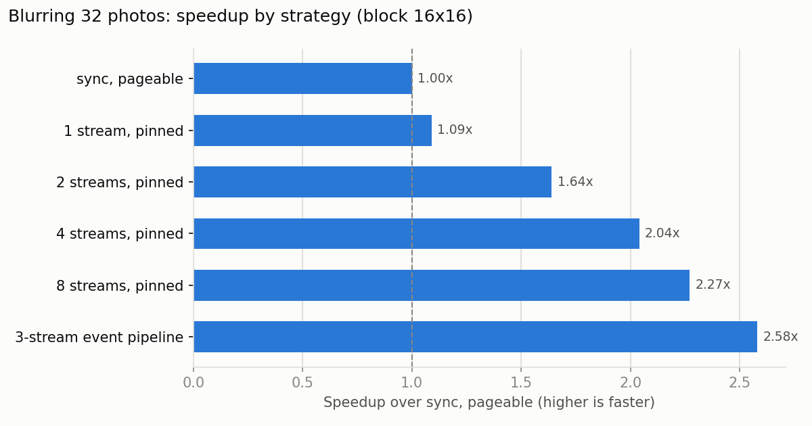
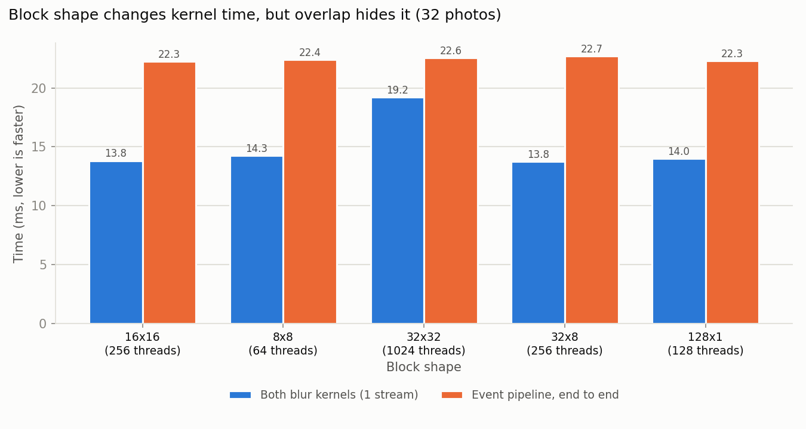

## Cover Sheet

**Name:** Nolan Pye
**Assignment:** EN605.617 – Introduction to GPU Programming, Module 6 — CUDA Streams and Events

---

## What the program does

It blurs a batch of sports photos on the GPU. Six photos (basketball,
football, soccer, tennis, track and volleyball, all 1280x720, in `images/`)
are repeated to fill a batch of 32. Each run copies the batch to the GPU
(118 MB), blurs it, and copies it back.


*Figure 1. One photo from the batch, before and after.*

The blur is a **Gaussian blur**: each pixel becomes a weighted average of
its neighbours, with closer pixels counting more. It is done in two
kernels:

1. **Kernel 1 – horizontal blur:** averages 25 pixels along each row.
2. **Kernel 2 – vertical blur:** averages 25 pixels along each column of
   kernel 1's output.

Doing rows and then columns gives the same result as a full 2-D blur, but
with 50 reads per pixel instead of 625. The 25 weights are stored in
constant memory because every thread reads the same weight at the same
time.

The program does the same work in several ways. **The kernel code is
identical every time**; only how the work is spread across streams
changes.

| Version | How the work is scheduled |
|---------|---------------------------|
| sync, pageable | Plain `cudaMemcpy` from normal (pageable) memory and the default stream. Nothing overlaps. This is the baseline. |
| 1 stream, pinned | `cudaMemcpyAsync` from pinned memory in one stream. Still no overlap. |
| 2 / 4 / 8 streams, pinned | The 32 photos are split into 2, 4 or 8 groups, one stream per group. While one group is copying, another group is being blurred. |
| 3-stream event pipeline | One stream copies photos in, one blurs them, one copies them out, one photo at a time. **Events** link them: `cudaEventRecord` marks "photo *p* has arrived" or "photo *p* is blurred", and `cudaStreamWaitEvent` makes the next stream wait for that mark. |

**How events are used:**
- **Timing.** A start and stop event bracket every run
  (`cudaEventRecord` → `cudaEventSynchronize` → `cudaEventElapsedTime`).
- **Stage breakdown.** Events placed between each copy and kernel time
  every step on its own.
- **Dependencies between streams.** In the event pipeline, events make
  sure a photo is never blurred before it arrives, or copied back before
  it is blurred.

**Test harness:** each version runs once to warm up, then **3 timed runs**,
all printed. `run.sh` repeats this for **7 configurations**: 5 block shapes
(64 to 1,024 threads per block) and 3 batch sizes (8, 32, 64 photos).
Every version's output must match the baseline **bit for bit**, and the
baseline is checked pixel by pixel against the same blur done on the CPU.
All versions passed in every run. The blurred photos are saved to
`output/`.

---

## Results



*Figure 2. Speedup over the synchronous baseline (32 photos, 16x16
blocks).*

### Where the time goes (one stream, timed with events)

| Copy in | Kernel 1 (horizontal) | Kernel 2 (vertical) | Copy out | Total |
|--:|--:|--:|--:|--:|
| 18.7 ms | 7.0 ms | 6.8 ms | 18.1 ms | 50.6 ms |

Copying the photos takes **more than twice as long as blurring them**.
With one stream these steps run one after another. With several streams
they overlap. The best possible time is the longest step (18.7 ms), since
that step can't be hidden.

### Key takeaways

- **Streams made the whole job 2.1–2.6x faster.** At 32 photos the event
  pipeline took 22.3 ms, compared with 57.5 ms for the baseline and only
  3.6 ms above the 18.7 ms best case.
- **The 3-stream event pipeline was the fastest version in 6 of the 7
  configurations.** It works one photo at a time, so it overlaps work 32
  times instead of 8. The exception was the smallest batch (8 photos),
  where 8 streams won by 0.14 ms because there were only 8 photos to
  overlap.
- **More streams help, but less each time.** 1 → 2 streams gave the
  biggest jump (1.4–1.6x). 4 → 8 added less, because only the first and
  last groups can't be overlapped, and those shrink as the groups get
  smaller.
- **Pinned memory alone did almost nothing here (5% slower to 9% faster).** Its value
  is that it makes overlap *possible*: `cudaMemcpyAsync` only runs
  alongside other work when the host memory is pinned.
- **The GPU has 2 copy engines**, so one photo can copy *in* while another
  copies *out* and a third is being blurred.

### Effect of block shape (threads per block)



*Figure 3. Block shape changes how long the blur kernels take (blue), but
the event pipeline's total time (orange) barely changes.*

- **Four of the five shapes took about the same time for the kernels
  (13.8–14.3 ms).** Only **32x32 (1,024 threads) was clearly slower (19.2
  ms, 39% slower than 16x16).** This GPU can hold at most 1,024 threads on
  each multiprocessor, so a 1,024-thread block fills one completely. The
  next block can't start until every thread in the current one is done,
  which likely leaves the multiprocessor partly idle each time a block
  finishes. Smaller blocks let several run side by side and fill those
  gaps.
- **The total time barely changed (22.3–22.7 ms)** because the blur runs
  while copies are happening. Copying sets the total time, so a slower
  kernel is still hidden behind the next copy. This is why 32x32 shows
  the highest speedup (2.60x): its slow kernels hurt the baseline, but not
  the pipeline.

### Effect of batch size

- **The smallest batch gained the least: 2.1x at 8 photos**, versus 2.6x
  at 32 and 2.4x at 64. Overlap can't help at the very start (nothing to
  blur yet) or the very end (nothing left to copy in), and with few photos
  those parts are a bigger share of the total.

### Timing table (average ms of 3 timed runs)

| Block | Photos | sync | 1 stream | 2 streams | 4 streams | 8 streams | event pipeline | best speedup |
|--:|--:|--:|--:|--:|--:|--:|--:|--:|
| 16x16 | 32 | 57.46 | 52.75 | 35.13 | 28.15 | 25.32 | **22.25** | 2.58x |
| 8x8 | 32 | 53.44 | 53.50 | 35.38 | 28.13 | 24.81 | **22.42** | 2.38x |
| 32x32 | 32 | 58.68 | 61.39 | 38.58 | 29.79 | 25.27 | **22.56** | 2.60x |
| 32x8 | 32 | 53.25 | 54.30 | 35.53 | 28.65 | 25.20 | **22.70** | 2.35x |
| 128x1 | 32 | 57.67 | 55.92 | 35.16 | 28.29 | 24.89 | **22.32** | 2.58x |
| 16x16 | 8 | 13.53 | 14.27 | 9.98 | 7.59 | **6.45** | 6.59 | 2.10x |
| 16x16 | 64 | 107.39 | 104.98 | 70.19 | 56.55 | 49.92 | **44.50** | 2.41x |

*Note: the sync column varies more than the others (53–58 ms at 32 photos)
because the laptop GPU's clock speed changes between runs, and the first
configuration ran while the GPU was still warming up. Comparisons within a
row are still fair. Full output is in `results.txt`.*

---

## Build and run

```bash
./build.sh                                  # build
./run.sh                                    # all seven configurations
./run.sh <blockX> <blockY> [batchSize]      # one run
```

Hardware: NVIDIA GeForce GTX 1650 Ti (16 SMs, 2 copy engines).
