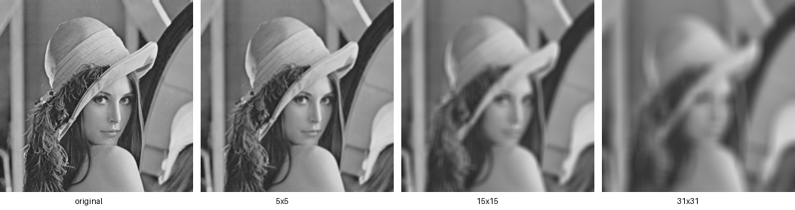

# Module 8 Practical Activities – NPP, Thrust, nvGRAPH

Run everything with `./run_practicals.sh`. The full log from a GTX 1650 Ti
(Turing, SM 7.5, 16 SMs, 4 GB, CUDA 13.0) is in `practicals_output.txt`.
CPU baselines are single-threaded, straightforward loops, so the speedups are
"GPU library vs. code you would write first", not vs. tuned CPU libraries.

Each program run with no arguments does what the original sample did. New
behavior is opt-in through flags.

## The common thread

All three libraries let you describe *what* to compute on GPU-resident data
and leave the kernels to NVIDIA:

| | NPP | Thrust | nvGRAPH |
|---|---|---|---|
| Data container | `ImageNPP_8u_C1` (pitched device image) | `device_vector<T>` | graph descriptor (CSC topology + vertex/edge data) |
| Setup | `NppStreamContext` | none (RAII vectors) | `nvgraphCreate`, `nvgraphCreateGraphDescr` |
| Operation | `nppiFilterBoxBorder_8u_C1R_Ctx` | `transform`, `reduce`, `sort`, ... | `nvgraphPagerank` |
| Getting results | `copyTo` host image | `host_vector = device_vector` | `nvgraphGetVertexData` |

The recurring lessons are the same ones the lectures stressed: **keep data on
the GPU**, because transfers and per-call overhead dominate small problems, and
**let the library own the algorithm** unless you have measured a reason not to.

---

## 1. NPP – `boxFilterNPP/boxFilterNPP.cpp`

**Purpose.** Blur an 8-bit grayscale image with a box filter: each output
pixel is the mean of a `mask × mask` neighbourhood.

**How it uses NPP.**
- `npp::ImageCPU_8u_C1` (host) and `npp::ImageNPP_8u_C1` (device) come from
  `common/UtilNPP`. The naming pattern from the syntax slides is
  `Image<where>_<type>_<channels>`: `8u` = 8-bit unsigned, `C1` = one channel.
- Copy-constructing an `ImageNPP` from an `ImageCPU` *is* the upload:
  `nppiMalloc_8u_C1` allocates a **pitched** buffer (rows padded for
  alignment), then a 2D copy fills it. That is why every NPP call takes both a
  pointer and a `pitch()` (row stride in bytes).
- `nppiFilterBoxBorder_8u_C1R_Ctx(src, srcPitch, srcSize, srcOffset, dst,
  dstPitch, roiSize, maskSize, anchor, NPP_BORDER_REPLICATE, ctx)`:
  - the name follows the slide pattern `nppi` + `Filter<Name>` + `_8u_C1` +
    `R` (works on a ROI) + `_Ctx` (stream context);
  - `oAnchor = {mask/2, mask/2}` centres the mask on the output pixel;
  - the `Border` variant with `NPP_BORDER_REPLICATE` reads past the image edge
    by repeating edge pixels, so the output is the same size as the input. The
    older non-border `nppiFilterBox` needed a shrunken ROI instead.
- `oDeviceDst.copyTo(host)` downloads the result.

**What changed.**
- **CUDA 13 port.** NPP 13 only ships the `_Ctx` API. Plain
  `nppiFilterBoxBorder_8u_C1R` no longer exists, and neither does
  `nppGetStreamContext`. `makeNppStreamContext` fills `NppStreamContext` from
  `cudaGetDeviceProperties` and attributes. The context is how NPP learns
  which stream to launch on and how to size its grid.
- **Image I/O.** `ImageIO.h` depends on FreeImage, which is only vendored for
  Linux and macOS, so small P5 PGM read/write functions replace
  `npp::loadImage` / `npp::saveImage`.
- **New flags:**
  - `-mask=N`: box size.
  - `-size=N`: use a synthetic N×N image instead of a file.
  - `-iters=N`: number of timed runs.
- **Added measurements:** event timing for upload, filter (one warm-up run,
  then the average) and download, plus a CPU box filter that checks the result
  pixel by pixel.
- **Shared header fix.** `common/inc/helper_cuda.h`'s `findCudaDevice` read
  `cudaDeviceProp::computeMode` / `clockRate`, which CUDA 13 removed. It now
  uses `cudaDeviceGetAttribute`, which works on every CUDA version.

**Results.** Kernel times are the average of 20 runs. The 5×5 mask is the
default.



| image | mask | NPP kernel | CPU | kernel speedup | incl. H↔D |
|---|---|---|---|---|---|
| Lena 512² | 3 | 0.014 ms | 5.0 ms | 360× | 5× |
| Lena 512² | **5** | 0.027 ms | 13.2 ms | 483× | 12× |
| Lena 512² | 7 | 0.199 ms | 19.5 ms | 98× | 17× |
| Lena 512² | 15 | 0.702 ms | 83.7 ms | 119× | 53× |
| Lena 512² | 31 | 2.747 ms | 281 ms | 102× | 77× |
| Lena 512² | 4 (even) | 0.097 ms | 6.4 ms | 66× | 6× |
| 1024² | 5 | 0.057 ms | 39 ms | 681× | 25× |
| 4096² | 5 | 0.451 ms | 591 ms | 1311× | 62× |
| 8192² | 5 | 1.507 ms (44.5 GPix/s) | 2419 ms | 1605× | 65× |
| 4096² | 15 | 24.1 ms | 4532 ms | 188× | 141× |

**Takeaways.**
- **Bit-exact with a plain C loop.** The NPP output matches the CPU
  reference exactly, including borders, once the CPU **truncates** the mean
  (`sum / area`). Rounding to nearest gave ±1 differences on about half the
  pixels. A reference implementation is how you find out what a library
  actually does.
- **Transfers dominate a single filter.** On Lena the kernel is 0.027 ms
  but upload plus download is about 1 ms, so the end-to-end speedup is about
  12×, not about 480×. The slide's advice to "keep it on the GPU for
  visualization or later processing" is the whole game: chain NPP calls on
  device images and only download at the end.
- **NPP has fast paths.** 3×3 and 5×5 run at 10–45 GPix/s, while 4×4 (even)
  and 7×7 are 3.5–7× slower than 5×5 *despite similar or less work*. Beyond the
  fast sizes the cost grows roughly with mask area (from 15 to 31 is about
  4×), so this is a direct sum, not a running-sum algorithm. For very large
  boxes, an integral image (`nppiIntegral`) gives constant cost per pixel.
- **Throughput grows with image size** (9.6 → 44.5 GPix/s) as the launch
  overhead is amortized and the GPU fills up. Small images cannot saturate the
  GPU.
- **Even masks** have no centre, so `mask/2` anchors the box half a pixel
  off. The output is correct but shifted.
- **`_Ctx` is now mandatory.** The context is also what lets NPP run on a
  non-default stream, so NPP stages can overlap with copies or other kernels.

---

## 2. Thrust – `thrust_examples/thrust_example.cpp`

**Purpose (original).** Introduce Thrust's two containers: create a
`host_vector`, set and resize it, copy it to a `device_vector` with `=`,
modify device elements with `D[i] = ...`, and print them.

**How it works.**
- `thrust::device_vector<int> D = H;` allocates device memory and copies with
  one `cudaMemcpy`. There's no `cudaMalloc` or `cudaMemcpy` in user code, and
  RAII frees everything at scope exit.
- `D[i]` returns a `device_reference`. Reading or writing it is a hidden
  single-element `cudaMemcpy`. That is convenient in a demo and a trap in a
  loop.
- The file is `.cpp`, so it must be compiled as CUDA (`nvcc -x cu`) for the
  device backend. Current Thrust (CCCL) also requires `-std=c++17`.

**What changed.** With no args the output is the original's. With
`thrust_example N [seed]` it also runs a random-data demo:
- **Generation.** `thrust::transform` over a `counting_iterator` with a
  `random_int` functor generates N random ints in [0, 1000) on the device.
  Each element seeds a `thrust::default_random_engine`, calls `discard(i)`,
  and draws from `uniform_int_distribution`. The functor is
  `__host__ __device__`, so the *same code* runs through `std::transform` on
  the host as a reference.
- **Storage.** A bulk `host_vector H = D` copy, compared with 1000 single
  `D[i]` reads.
- **Algorithms, Thrust vs. STL:** `reduce` vs. `std::accumulate`, `count_if`,
  `minmax_element`, `sort` vs. `std::sort`, each checked for agreement.

**Results** (GPU ms / CPU ms):

| N | generate | reduce | count_if | minmax | sort | bulk D→H |
|---|---|---|---|---|---|---|
| 1,000 | 0.09 / 0.04 | 0.15 / 0.00 | 0.08 / 0.00 | 0.30 / 0.00 | 0.09 / 0.04 | 0.03 |
| 1M | 0.69 / 85 | 0.24 / 0.35 | 0.12 / 0.67 | 0.34 / 2.2 | 1.15 / 38 | 1.5 (2.7 GB/s) |
| 16.7M | 11.9 / 1714 | 0.51 / 5.6 | 0.53 / 11.9 | 0.86 / 46 | 11.1 / 639 | 20 (3.3 GB/s) |
| 33.5M | 24.4 / 3655 | 0.85 / 11.4 | 0.88 / 22.6 | 1.3 / 79 | 20.0 / 1308 | 53 (2.5 GB/s) |

A single `D[i]` read costs **12–15 µs**, regardless of N.

**Takeaways.**
- **Per-element access is a hidden `cudaMemcpy`.** Reading 1000 elements one
  at a time (14 ms) takes almost as long as copying all 16.7M elements in bulk
  (20 ms for about 16,700× more data). Move data in bulk and compute with
  algorithms, never with `D[i]` in a loop.
- **Below about 10⁵ elements the CPU wins.** At N = 1000 every Thrust call
  costs 0.1–0.3 ms of launch, allocation and synchronization overhead.
  Reductions that return a value (`reduce`, `count_if`, `minmax_element`)
  also block until the result is back on the host.
- **At scale the slide claims hold and then some:** `sort` is 33–65× faster
  than `std::sort` (the slides say "at least 5×"), and at 16.7M+ elements
  reductions are 10–60× (`reduce` about 11×, `count_if` about 23×,
  `minmax_element` about 55×).
  Thrust's sort for primitive keys is a radix sort, not a comparison sort.
- **Counter-based random generation parallelizes.** Each element's value
  depends only on `(seed, i)`, so there's no shared generator state, the
  result is independent of thread order, host and device agree bit for bit,
  and the same seed reproduces the same data (the two `1000 1234` runs are
  identical; seed 42 differs). `discard(i)` is a logarithmic jump-ahead for
  the LCG, so it stays cheap even for large i.
- **Thrust looks like STL code.** The GPU and CPU versions differ only in
  the container type and namespace, which is the point of the library.
- **Gotcha found while porting.** `thrust::equal(D.begin(), D.end(),
  H.begin())` mixes device and host iterators and crashed at runtime.
  Algorithms need both ranges in the same memory space.
- **Allocation isn't free.** `device_vector D(n)` is `cudaMalloc` plus a
  fill kernel (2–6 ms here). Reuse vectors instead of recreating them.

---

## 3. nvGRAPH – `nvgraph_examples/nvgraph_Pagerank.cpp`

**Purpose.** Compute PageRank for a 6-vertex, 10-edge directed graph at two
damping factors, α = 0.85 and then α = 0.90. The second run uses the first
result as its initial guess. The expected answer for α = 0.90 comes from
Langville & Meyer.

**How it uses nvGRAPH (original code).**
1. `nvgraphCreate` → handle, `nvgraphCreateGraphDescr` → graph.
2. The topology is given in **CSC**, grouped by *destination*:
   `destination_offsets[v]..[v+1]` indexes the `source_indices` that link
   *into* v. `nvgraphSetGraphStructure(..., NVGRAPH_CSC_32)` uploads it.
3. Data is attached as numbered sets: `nvgraphAllocateVertexData` with 3
   vertex sets (0 = bookmark, 1 = pr_1, 2 = pr_2) and `nvgraphAllocateEdgeData`
   with 1 edge set (the weights, `1/outdegree(source)`).
4. The **bookmark** marks dangling vertices, which have no out-links (vertex 1
   here). Their rank would otherwise leak out of the system.
5. `nvgraphPagerank(handle, graph, weight_idx, &alpha, bookmark_idx,
   has_guess, pagerank_idx, tolerance, max_iter)`. `0`/`0` means the default
   tolerance and iteration limit.
6. `nvgraphGetVertexData` downloads the result.

Code-reading notes:
- The header comment's `W0` list ends in `1.00`, but the code's last weight is
  `0.5`. The code is right: 4 → 5 has weight 1/outdeg(4) = 0.5.
- The setup loop `for (i = 0; i < 2; ++i) nvgraphSetVertexData(...)` uploads
  the uninitialized `pr_1`. That's harmless only because the first run has
  `has_guess = 0`.

**nvGRAPH no longer exists.** It was deprecated in CUDA 10 and removed in
CUDA 11 (its successor is RAPIDS **cuGraph**, a Linux/Python stack). The
original cannot be built with CUDA 13, so `pagerank_cusparse.cu` reproduces
`nvgraphPagerank` with libraries that still ship:
- PageRank is the dominant eigenvector of the Google matrix, found with the
  **power method**:
  `x ← α·Hx + (α·(a·x) + (1−α)·Σx)/n`, normalized to L1 = 1, until
  `‖Δx‖₁ < tol`.
- nvGRAPH's CSC-by-destination arrays are exactly **CSR of H with rows =
  destinations**, so `Hx` is one `cusparseSpMV` (the module 7 library) on the
  unchanged arrays. The scalar parts are Thrust: `inner_product` for the
  dangling mass, `reduce`, `transform`, and `transform_reduce` over a
  `zip_iterator` for the residual.
- It runs the same two runs on the same graph and prints the same output. It
  adds a double-precision CPU reference, per-iteration timing, the SpMV share
  of the time, and these flags:
  - `-alpha` and `-tol` change the damping factor and tolerance;
  - `-n` and `-deg` build a random graph with a skewed in-degree.

**Results.**

Sample graph:
- `pr_2` = (0.037212, 0.053958, 0.041506, 0.375081, 0.205998, 0.286246),
  within 4.6e-5 of the published values, which are themselves rounded to
  4–5 digits.
- `pr_1` agrees with the double-precision CPU to 3.7e-8 (L1).

Sample graph, varying α and tolerance:

| run | iterations (run 1 / warm-started run 2) | note |
|---|---|---|
| α 0.85 → 0.90 (initial) | 24 / 23 | a cold start at 0.90 takes 27 |
| α 0.5 | 13 / 1 | run 2 starts at the answer |
| α 0.99 | 33 / 1 | vertices 0–2 drop to about 0.005 |
| tol 1e-3 | 12 / 9 | error vs. expected 3.3e-4 |
| tol 1e-9 | **500 (cap)** / 40 | float can't reach 1e-9; the CPU in double needs 37 |

Random graphs (average out-degree 8 unless noted):

| vertices | edges | GPU ms/iter | SpMV share | CPU ms/iter | speedup |
|---|---|---|---|---|---|
| 6 (sample) | 10 | 0.69 | 71% | 0.001 | 0.001× |
| 10K | 80K | 0.54 | 55% | 0.15 | 0.27× |
| 100K | 0.8M | 0.73 | 67% | 2.5 | 3.5× |
| 1M | 8M | 6.2 | 92% | 52 | 8.5× |
| 4M | 32M | 31.4 | 96% | 360 | 11.5× |
| 1M, deg 2 | 2M | 2.1 | 79% | 23 | 10.7× |
| 1M, deg 32 | 32M | 21.1 | 97% | 165 | 7.8× |

**Takeaways.**
- **Graph analytics is sparse linear algebra.** nvGRAPH's PageRank is a
  repeated sparse matrix-vector product plus a few reductions. Its CSC input
  is a sparse-matrix format, and SpMV takes over 90% of the time at scale.
  That is why NVIDIA could fold this functionality into cuSPARSE and cuGraph.
- **Below about 50K vertices the GPU loses.** Each iteration has a floor of
  about 0.3–0.5 ms: one SpMV, four Thrust reductions that each synchronize and
  copy a scalar to the host, and temporary allocations. The 6-vertex sample
  takes 0.7 ms per iteration on the GPU vs. 1 µs on the CPU. nvGRAPH was
  built for graphs with millions to billions of edges, as the lecture says.
- **At scale the GPU wins by about 8–12×**, against a single CPU thread here
  (the lecture quotes about 3× vs. a multi-core CPU).
- **SpMV is limited by irregular memory access, not bandwidth.** At 32M edges
  it runs at about 40 GB/s effective, against about 192 GB/s peak. The
  `x[source]` gathers are random. With the same 32M edges, 1M vertices
  (4 MB rank vector) runs 1.5× faster than 4M vertices (16 MB vector), which
  fits the gather-locality explanation. The 1650 Ti's L2 is 1 MB. cuSPARSE's
  load-balanced `CSR_ALG2` didn't help (34 vs. 31 ms/iter), so the skewed
  in-degree, where vertex 0 receives about 200K edges, is not the limiting
  factor.
- **Warm starts matter.** Starting α = 0.90 from the α = 0.85 answer took 23
  iterations, vs. 27 from a uniform start. Starting from the answer for the
  same α converges in 1 iteration. Recomputing after a small change is cheap.
- **α trades realism for speed and stability.** The power method converges
  at a rate bounded by α. At α = 0.99 the rank drains into the closed cycle
  {3, 4, 5}, and vertices 0–2 fall to about 0.005: with little teleportation,
  rank sinks into subgraphs with no way out. α = 0.85 is the usual
  compromise.
- **Precision sets a floor on the tolerance.** In float the L1 residual
  stalls at about 1e-7, so `tol = 1e-9` never converges and burns all 500
  iterations. Always set `max_iter`, and pick a tolerance your precision can
  reach. The default 1e-6 is already near the float floor for large n.
- **Libraries get deprecated.** nvGRAPH arrived in CUDA 8 and was gone by
  CUDA 11. Building on the stable layers underneath (cuSPARSE, Thrust), and
  knowing the algorithm well enough to rebuild it, kept the core solver of
  this port to about 100 lines.

## Environment notes (this machine)

- NPP was added to the module 7 conda env:
  `conda install -n gpu_mod7 -c nvidia cuda-version=13.0 libnpp-dev`.
  Thrust ships with `nvcc` (CCCL). cuSPARSE was already in the env.
- To run from Git Bash on Windows:

  ```bash
  E=$(cygpath -m ~/anaconda3_new/envs/gpu_mod7/Library)
  export PATH="/c/Program Files/Microsoft Visual Studio/2022/Community/VC/Tools/MSVC/14.37.32822/bin/Hostx64/x64:$HOME/anaconda3_new/envs/gpu_mod7/Library/bin:$PATH"
  NVCC_EXTRA="-I$E/include -L$E/lib/x64" ./run_practicals.sh
  ```

  On Linux with a normal CUDA toolkit, `./run_practicals.sh` alone works.
- The per-folder `Makefile`s are the original cuda-samples ones. They link
  the old monolithic `nppi_static` and FreeImage, which no longer match the
  code or current toolkits. Use `run_practicals.sh`.
- `helper_cuda.h` prints "MapSMtoCores for SM 7.5 is undefined". Its core
  table predates Volta. This is harmless: it only affects which GPU
  `findCudaDevice` picks when there are several.
